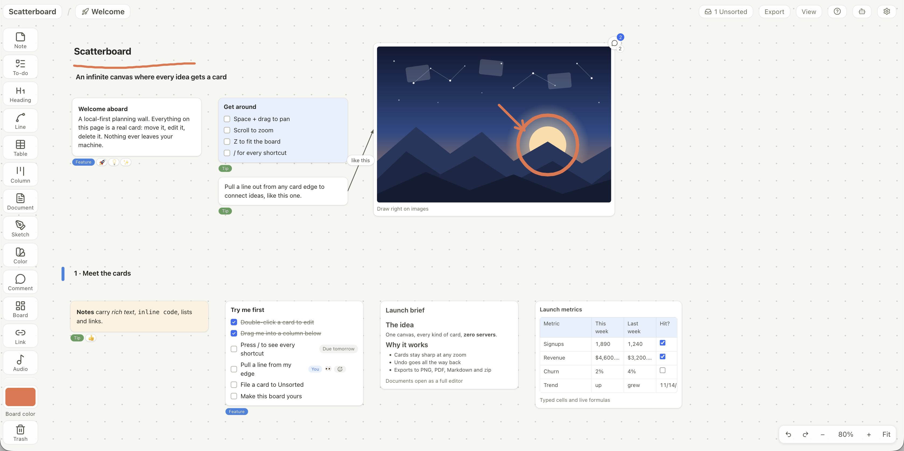

# Scatterboard

Local-first infinite-canvas planning board: notes, to-dos, tables,
documents, drawings, embeds, files, and nested boards on one dot
grid. No accounts, no servers, no tracking; the workspace lives in
the browser and works offline. MIT licensed, original code, copy, art,
and icons.



```
npm install && npm run dev    # then open http://localhost:5173
```

First steps: double-click the canvas for a note, drag more card types
from the left rail, and press `/` for the full shortcut map.

## Why it is different

- Your boards are yours: the whole workspace lives in the browser's
  storage, works offline, and never phones home.
- Boards nest like folders: a board card on a board opens a child
  board, so big plans stay tidy without leaving the canvas.
- 17 card types, rich text, table formulas, drawing tools, comments,
  search, undo history, and export to PNG, PDF, Word, Markdown, plain
  text, zip, and JSON.
- Backup stays yours too: Settings can mirror the workspace and its
  media into a folder you pick (a synced folder doubles as device
  sync), and Version history keeps named snapshots you can roll back
  to, plus a daily automatic one.
- Two tabs stay safe: a save in one updates the other instead of
  silently overwriting it.
- Installable as an app (Help > Install app): one visit stores the
  whole bundle for offline use, and sharing text or links to it files
  a note in Unsorted.

## The tour

### Canvas and boards

- Pan with Space+drag, middle mouse, or trackpad; zoom with
  Cmd/Ctrl+wheel or Cmd/Ctrl+=/-/0; `Z` fits the board.
- A corner minimap shows the board's cards and the visible area; click
  or drag it to pan. View > Minimap hides it.
- Boards nest through board cards: double-click to enter, breadcrumbs
  or Cmd/Ctrl+U to come back. Routes are `#/b/<id>`; editors live at
  `#/e/<id>`.
- Column cards stack members inline and convert into a nested board in
  one undoable step.
- Connector lines attach to card edges and re-attach by dragging an
  end; per-end arrow/dot markers, a midpoint label, dashes, and three
  weights. A connect handle on the selected card draws one in a drag.
- An Unsorted inbox holds unfiled cards (Alt+` files the selection); a
  Trash panel groups deleted cards by day and restores by drag.
- Board search (Cmd/Ctrl+F) scans every text field on the current
  board, including table cells, link URLs, and comments, skipping
  Unsorted, and sorts by relevance, modified, or last viewed. A scope
  switch widens it to every board in the workspace.

### 17 card types

| Card | Holds |
|---|---|
| Note | rich text |
| Heading | single-line large text, two levels |
| To-do | checkbox list with per-item due dates and times |
| Link | URL card with an optional unfurled preview |
| Video / Audio / Map | provider iframe embeds (3 types) |
| Board | nested board with a live member count |
| Column | inline container stacking member cards |
| Comment | thread pinned to a card, or free on the board |
| Color swatch | colour block with hex, auto name, caption |
| Document | long-form text in a dedicated editor |
| Table | cell grid with formulas |
| Sketch | in-card drawing |
| Annotation | freehand stroke overlay on the board |
| Image | blob image with caption |
| File | any other file, with download and open |

Plus connector lines, and whatever lands on the canvas: dropped images
become image cards, other files become file cards.

Every selected card gets the same rail toolbox: colour, labels,
reactions, comments, rename, lock, z-order, and type conversions (note
to document, column to board, and more). Right-click a card for the
same tools as a menu.

### Text editing

Notes, headings, documents, and table cells share one rich-text engine:
seven block styles, bold/italic/underline/strikethrough, six text
colours and highlights, bullet/numbered/checkbox lists, hyperlinks,
inline code, and line-start markdown autoformat. Double-click a
document card for its own editor, with word count and export to Word,
Markdown, or plain text.

### Tables

Per-cell types (number, currency, percent, date, text, checkbox),
per-cell colour and alignment, rich text in cells, and six formula
functions (`SUM`, `IF`, `MIN`, `MAX`, `COUNT`, `AVERAGE`) over A1
references and ranges; typing `=` opens a formula autocomplete, and
edge grips resize and reorder columns while editing. Number, currency,
and date cells format through Intl using the locale and currency set in
Settings.

### Drawing

A pressure-sensitive pen (per-point stroke widths) in three places:
sketch cards on a fixed 600x450 pad, draw-on-image annotation, and
board draw mode (Shift+D) that saves as an annotation element. Strokes
are selectable, erasable, and undoable; annotations download as SVG.
The image editor also crops, rotates, flips, and cuts out backgrounds,
all client-side.

### Organize and present

Labels with colours, emoji reactions, comment threads, four builtin
board templates plus saved snapshots, a searchable icon picker, quick
capture into Unsorted, synced note copies (duplicating a note can keep
the copies identical), a Due panel that gathers every dated to-do item
across boards, overlap prevention that pushes neighbours when
a card grows, a per-board dot-grid toggle, a customizable create
palette, dark mode (Cmd/Ctrl+Shift+D), UI scale (Cmd/Ctrl+Shift+,/.),
and a presentation mode (Cmd/Ctrl+Alt+P) with "Focus on selected
cards" and "Prevent editing". The UI ships in English, Deutsch,
Español, Français, and Português.

### In and out

In: drag files onto the canvas, paste images or URLs, JSON import, or
quick capture. Out: the topbar Export menu offers board PNG, PDF
(standard and high quality), a linear reading order as Word (.doc),
Markdown, or plain text with an "Include sub-boards" toggle, a zip of
every image and file, and full-board JSON. JSON export/import doubles
as device-to-device sync.

### Agents & MCP

External AI agents can drive a live board: create, patch, connect, and
remove cards, upload files, read boards and elements, search, select,
pan/zoom, present, undo/redo, import/export, and take PNG snapshots,
all as normal undoable history. Two entry points, both opt-in:

- Command links. `?do=<base64url JSON>` in the URL runs a command list
  once at boot inside one undo entry; a bad command leaves the board
  untouched, and a list containing mutations asks for confirmation
  first. The payload is `{commands:[{method,params}]}` or a bare
  array. The full method set mirrors the `sb_*` tools listed below.
- Local bridge + MCP. One command registers the bridge (Node >=20)
  wherever it finds a compatible MCP host (Devin, Windsurf, Cursor,
  Claude Desktop/Code, Gemini CLI; any stdio MCP client works, manual
  config in `bridge/README.md` for the rest):

  ```
  npx -y scatterboard-mcp install
  ```

  Then, from your agent: `sb_status` prints the pairing URL and
  `sb_open` opens the app tab to pair it. The app asks you to
  confirm in a centered dialog; click Connect. Pairing switches on the Local
  agent setting and stores a key, so later sessions reconnect
  without the URL. One app tab holds the session at a time; a
  second tab stays disconnected until the first closes.
  The `sb_*` tools cover the
  whole board: `sb_boards`, `sb_state`, `sb_labels`, `sb_search`,
  `sb_openboard`, `sb_elements`, `sb_get`, `sb_create`, `sb_patch`,
  `sb_remove`, `sb_connect`, `sb_trash`, `sb_restore`, `sb_emptytrash`,
  `sb_select`, `sb_view`, `sb_present`, `sb_snapshot`, `sb_templates`,
  `sb_instantiate`, `sb_savetemplate`, `sb_upload`, `sb_export`,
  `sb_import`, `sb_unfurl`, `sb_duplicate`, `sb_undo`, `sb_redo`,
  `sb_batch`, `sb_dispatch`. The same JSON-RPC works directly on the
  WebSocket for non-MCP agents (`agentKey` from `sb_status`). For repo
  development, `npm run agent:setup` registers the checked-out
  `bridge/agent.mjs` instead of the npx package.

Every mutating command lands in the undo history and is refused while
presenting with editing locked.

## Keyboard

Press `/` in the app for the full map. Essentials:

| Do this | Keys |
|---|---|
| New note / chain another | double-click canvas / Cmd/Ctrl+Return |
| Pan / zoom / fit | Space+drag / Cmd/Ctrl+wheel / `Z` |
| Step through cards / edit | Tab or Shift+Tab / Enter |
| Search / present | Cmd/Ctrl+F / Cmd/Ctrl+Alt+P |
| Cut, copy, paste, paste styles | Cmd/Ctrl+X / C / V / Alt+V |
| Undo, redo | Cmd/Ctrl+Z / Cmd/Ctrl+Shift+Z |
| Duplicate / file to Unsorted | Cmd/Ctrl+D or Alt+drag / Alt+` |
| Eyedropper colour | `I` |
| Board draw mode | Shift+D |
| Dark mode / UI scale | Cmd/Ctrl+Shift+D / Cmd/Ctrl+Shift+,/. |
| Parent board / history | Cmd/Ctrl+U / Cmd/Ctrl+[ and ] |

## Privacy

The default path makes no network calls. Optional extras connect only
when used:

- "Enrich link cards" (on by default, Settings > Online extras)
  fetches a page's title and OG tags through the public
  `api.allorigins.win` CORS proxy, which sees the pasted URL.
- Video, audio, and map embed cards load provider iframes (YouTube,
  Vimeo, Spotify, SoundCloud, Google Maps) when added, and fetch the
  page's title through the same proxy.

Offline, both fall back to manual titles and placeholders.

- "Local agent" (off by default, Settings > Online extras) connects
  the app to a bridge you run yourself over `ws://127.0.0.1` only. The
  bridge pairs via a one-time token that rotates after use, never
  leaves the loopback interface, and stores one app key for tokenless
  reconnects (agent sockets use a separate key). While enabled, a
  local agent process can read and edit boards.

## Requirements

- A current Chrome/Edge, Firefox, or Safari, desktop or mobile. Boards
  are stored in SQLite on OPFS where available, falling back to
  localStorage.
- Desktop-first, but phones work: under 720px the tool rail becomes a
  bottom bar and popups dock as sheets; touch pans, pinch-zooms, and
  long-press starts a marquee.
- To run from source: Node >=20.19 (22 pinned in `.nvmrc`).

## Develop

```
npm install        # Node 22 pinned (.nvmrc); >=20.19 required
npm run dev        # Vite dev server
npm run build      # prebuild runs typecheck + tests first
npm test           # vitest suite in test/
npm run typecheck  # tsc --noEmit
npm run lint       # biome lint src test
npm run preview    # serve the build
```

On the dev server, `window.__app` exposes the App instance for poking:
`__app.selectOnly(id)`, `__app.store.doc`, `__app.vp`.

Deploy `dist/` to any static host as-is.

| Variable | Default | Effect |
|---|---|---|
| `SCATTERBOARD_BASE` | `./` | Vite base path for the build |

## Releases

The version lives in `package.json` and is baked into the build; the
app shows it under Help > About. To cut a release:

1. Update `CHANGELOG.md`: rename `Unreleased` to the new version with
   the date (`## [0.2.0] - 2026-01-15`) and open a fresh `Unreleased`.
2. `npm version patch|minor|major`: bumps `package.json`, commits, and
   tags `v*`. The `version` script syncs `bridge/package.json` and its
   lockfile to the same version automatically. (For a first release
   where `package.json` already holds the target version, run
   `npm version 0.1.0` or tag by hand with `git tag v0.1.0`; `patch`
   would produce the next version instead.)
3. `git push --follow-tags`

Pushing a `v*` tag runs the release workflow: it checks the tag
matches `package.json` (and that `bridge/package.json` is in sync),
builds, extracts the matching CHANGELOG section into the GitHub
release notes, and deploys `dist/` to Pages. The `scatterboard-mcp`
bridge package is published by hand after the tag:
`cd bridge && npm publish`.

## Architecture

Vanilla TypeScript + Vite, zero runtime dependencies; the production JS
ships in lazy chunks with the largest at ~102 KB gzipped against a
150 KB budget. Two render layers:
Canvas2D draws the dot grid, connectors, marquee, and selection chrome;
plain DOM renders cards and editing so text stays crisp at any zoom.
Every mutation is a typed action through one store with an
auto-inverse, which is what makes batched undo groups possible.
Persistence sits behind a storage adapter: SQLite WASM on the OPFS
sync-access-handle pool in a worker, localStorage as migration source
and fallback, media blobs in IndexedDB. The service worker (production
builds only) precaches the shell and walks the script bundle, so the
whole app works offline after one visit.

- [AGENTS.md](AGENTS.md): current source layout and conventions
- [ARCHITECTURE.md](ARCHITECTURE.md): the original design proposal,
  kept for context
- [CHANGELOG.md](CHANGELOG.md): release history
- [CONTRIBUTING.md](CONTRIBUTING.md): ground rules and PR checklist
- [SECURITY.md](SECURITY.md): reporting vulnerabilities
- [NOTICE.md](NOTICE.md): vendored third-party components

## Contributing and license

See [CONTRIBUTING.md](CONTRIBUTING.md) before opening a PR. MIT, see
[LICENSE](LICENSE). Scatterboard is an original work and is not
affiliated with any commercial product.
